<div align="center">


# Multi-DB Workbook

### Consulta, cruza y exporta datos empresariales sin escribir SQL

Una plataforma web que convierte una base de datos corporativa en una **hoja de cálculo segura y fácil de usar**,
pensada para equipos de **Recursos Humanos, Finanzas y Análisis** que necesitan información confiable sin depender de TI.

[](https://openjdk.org/projects/jdk/21/)
[](https://spring.io/projects/spring-boot)
[](https://react.dev/)
[](https://vitejs.dev/)
[](Dockerfile)

[](#-requisitos-previos)
[](#-requisitos-previos)
[](#-requisitos-previos)
[](#-requisitos-previos)
[](#-requisitos-previos)
[](#-requisitos-previos)
[](#-calidad-y-pruebas)
[](#-calidad-y-pruebas)
[](docs/cumplimiento-iso.md)
[](pom.xml)

[**Resumen**](#-el-proyecto-en-30-segundos) ·
[**Capturas**](#-capturas) ·
[**Funcionalidades**](#-funcionalidades) ·
[**Tecnología**](#-tecnología) ·
[**Mapas del sistema**](#-mapas-del-sistema) ·
[**Requisitos**](#-requisitos-previos) ·
[**Manual de uso**](#-manual-de-uso)

</div>

---

## ⚡ El proyecto en 30 segundos

| | |
|---|---|
| **El problema** | En RRHH y Finanzas la información vive en bases de datos (nóminas, cargos, centros de costo, liquidaciones). Para obtener un reporte hay que pedírselo a TI o aprender SQL, y los datos llegan llenos de códigos (`id_cargo = 118`) en vez de nombres. |
| **La solución** | Una aplicación web con apariencia de hoja de cálculo para **explorar tablas, traducir códigos a nombres reales, cruzar información de varias tablas y descargar el resultado en Excel**, todo con clics. |
| **Para quién** | Analistas de RRHH, Finanzas y Control de Gestión (uso diario) y administradores de bases de datos (modo técnico con diagnóstico del motor). |
| **Seguridad** | Consulta en **modo solo lectura** sobre los datos de negocio, acceso protegido por usuario y contraseña, y protección contra inyección SQL y fórmulas maliciosas en Excel. |
| **Alcance** | Aplicación full-stack completa: backend Java/Spring, frontend React, 6 motores de bases de datos, Docker y 369 casos de prueba automatizados. |

> [!IMPORTANT]
> **Herramienta de uso individual.** Está diseñada para que **una persona** la ejecute en su equipo o servidor y trabaje con **una conexión activa a la vez**.
> Tiene un único usuario de acceso, definido en la configuración, y si se cambia de base de datos el cambio aplica a toda la aplicación.
> No está pensada como plataforma multiusuario con cuentas y permisos distintos por persona (ver [Limitaciones](#-limitaciones-conocidas-y-próximos-pasos)).

---

## 🖼️ Capturas

> Imágenes con datos de demostración ficticios.

<table>
  <tr>
    <td width="50%">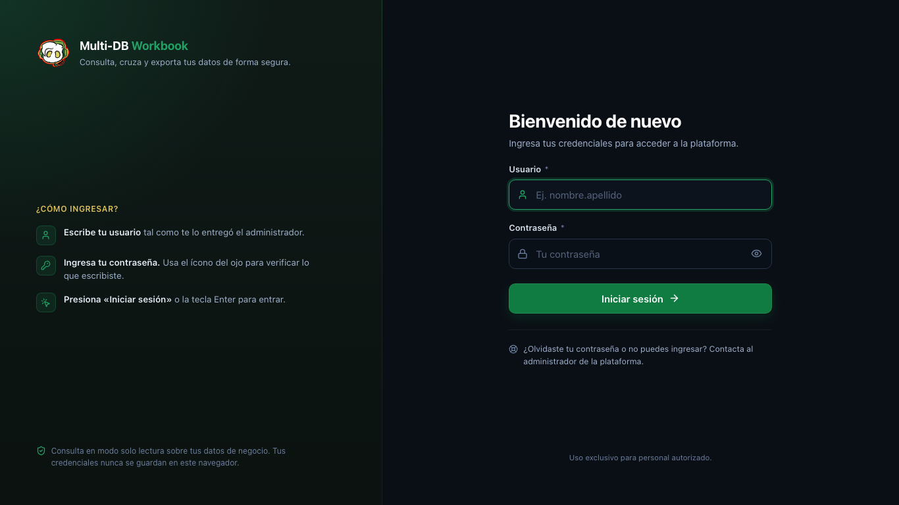<p align="center"><b>Acceso seguro</b>: alertas claras y guía de ingreso</p></td>
    <td width="50%">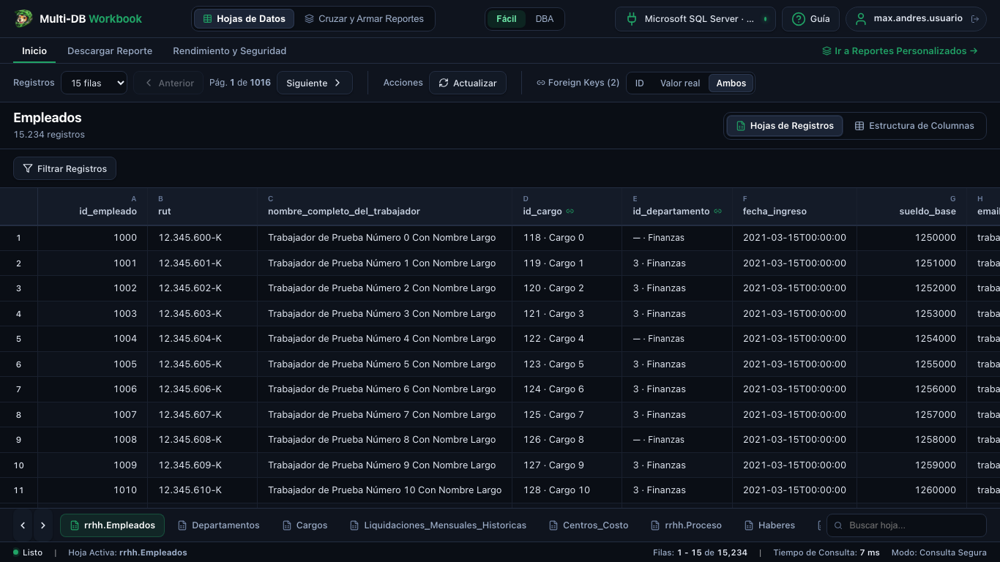<p align="center"><b>Explorador</b>: tablas como hojas, códigos traducidos a nombres</p></td>
  </tr>
  <tr>
    <td width="50%">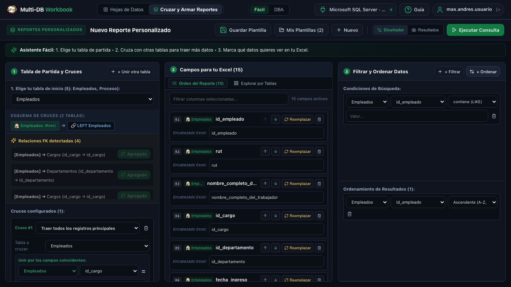<p align="center"><b>Constructor de reportes</b>: cruza tablas en 3 pasos</p></td>
    <td width="50%">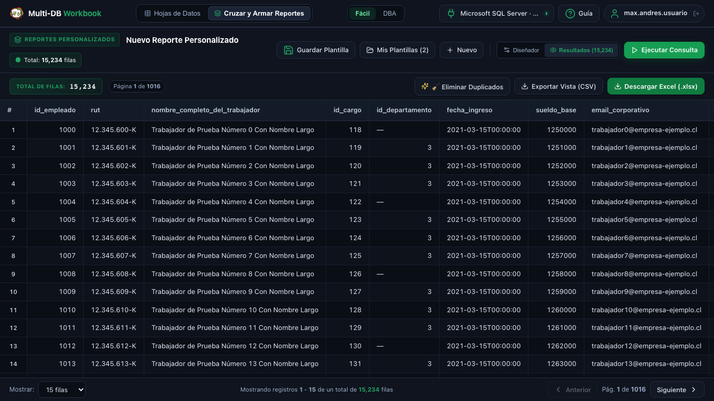<p align="center"><b>Resultados</b>: vista previa y descarga a Excel</p></td>
  </tr>
  <tr>
    <td width="50%">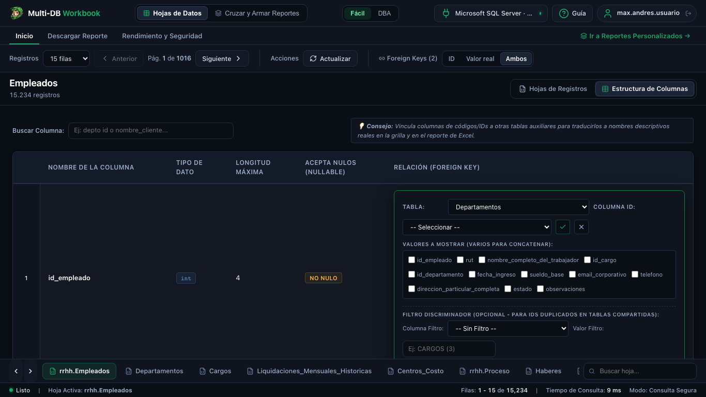<p align="center"><b>Relaciones</b>: vincula códigos con su descripción</p></td>
    <td width="50%" align="center">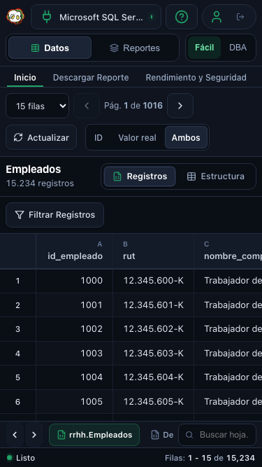<p align="center"><b>Responsive</b>: de móviles a monitores 4K</p></td>
  </tr>
</table>

---

## ✨ Funcionalidades

### Para el usuario de negocio (RRHH · Finanzas)

| Funcionalidad | Qué permite hacer |
|---|---|
| 📄 **Tablas como hojas de cálculo** | Cada tabla aparece como una pestaña, como en Excel. Se recorre página a página (10 a 100 filas) y se busca por nombre. |
| 🔍 **Filtros sin SQL** | Filtra cualquier columna con condiciones simples: *contiene, igual a, entre, mayor que, menor que, vacío, no vacío*. |
| 🔗 **Códigos convertidos en nombres** | Muestra `118 · Analista Contable` en lugar de solo `118`. Se puede elegir ver el código, el nombre o ambos. |
| 🧩 **Cruzar información de varias tablas** | Combina, por ejemplo, *Empleados + Cargos + Centros de Costo* en un solo reporte. El sistema **sugiere automáticamente** los cruces posibles. |
| ✏️ **Columnas a medida** | Elige qué columnas incluir, en qué orden y con qué encabezado aparecerán en el Excel final. |
| 🧹 **Eliminar duplicados** | Quita filas repetidas del reporte con un clic. |
| 📥 **Descarga a Excel y CSV** | Genera archivos `.xlsx` del reporte completo (hasta 50.000 filas por defecto) o un CSV rápido de la vista actual. |
| 💾 **Plantillas reutilizables** | Guarda un reporte (por ejemplo, *"Nómina mensual por centro de costo"*) y vuelve a ejecutarlo cuando lo necesites. |
| 🟢 **Modo Fácil** | Lenguaje simple, sin tecnicismos de bases de datos. Es el modo por defecto. |
| 📖 **Guía integrada** | Manual interactivo disponible en todo momento desde el botón **Guía**. |

### Para el perfil técnico (DBA · TI)

| Funcionalidad | Detalle |
|---|---|
| 🛠️ **Modo DBA** | Muestra esquemas, nombres técnicos, tiempos de consulta y el **SQL generado** para auditarlo. |
| 🔌 **Gestor de conexiones** | Conecta en caliente a SQL Server, PostgreSQL, MySQL, MariaDB, Oracle, SQLite o una URL JDBC directa, con **prueba de conexión y latencia** antes de aplicar. |
| 🩺 **Consola de diagnóstico** | Versión del motor, estado, modelo de recuperación, colación, conexiones activas y tamaño de los archivos de datos y log. |
| 🗂️ **Relaciones virtuales** | Declara relaciones entre tablas aunque la base de datos no tenga *foreign keys* formales (algo común en sistemas heredados). |

---

## 🧰 Tecnología

### Stack

| Capa | Tecnología | Uso en el proyecto |
|---|---|---|
| **Backend** | Java 21 (LTS) · Spring Boot 4.1 | API REST, seguridad, caché, monitoreo (Actuator) |
| | Spring Security | Login HTTP Basic + sesión de servidor (cookie `HttpOnly`, `SameSite=Lax`), límite de intentos |
| | Spring JDBC + HikariCP | Consultas dinámicas parametrizadas y pool de conexiones intercambiable en caliente |
| | Flyway | Migraciones versionadas del esquema propio de la aplicación |
| | Caffeine | Caché en memoria de metadatos (tablas, columnas, relaciones) |
| | Apache POI 5.3 (SXSSF) | Exportación a Excel en *streaming*, sin agotar la memoria |
| | Drivers JDBC | `mssql-jdbc`, `postgresql`, `mysql-connector-j`, `mariadb-java-client`, `ojdbc11`, `sqlite-jdbc` |
| **Frontend** | React 19 · Vite 6 | SPA con carga diferida (*lazy loading*) del módulo de reportes |
| | CSS moderno nativo | Sistema de diseño propio: tokens, Grid, Flexbox, `clamp()`, *container-friendly*, sin frameworks CSS |
| | lucide-react | Iconografía |
| **Calidad** | JUnit 5 · Spring MockMvc · Vitest · Testing Library · oxlint | 329 pruebas de backend + 40 de frontend · cobertura de líneas 88 % (mínimo exigido 80 %) · CI en GitHub Actions |
| **Infraestructura** | Docker multi-stage | Node 22 → JDK 21 → imagen final JRE 21 con usuario sin privilegios |

### Competencias técnicas que demuestra

- **Arquitectura en capas** con servicios especializados y el **patrón Strategy** (`DbDialect`) para soportar 6 motores de bases de datos con una sola base de código.
- **Seguridad aplicada**: *whitelisting* de identificadores contra el catálogo del motor, consultas parametrizadas, protección contra *CSV/Formula Injection*, *rate limiting* contra fuerza bruta, CSP y credenciales que nunca se guardan en el navegador.
- **Rendimiento**: paginación en el servidor, resolución de relaciones **sin el problema N+1** (una consulta por columna y página), caché con invalidación, exportación en *streaming* y un semáforo de concurrencia que protege el pool de conexiones.
- **UX/UI y accesibilidad**: diseño *mobile-first* validado de 320 px a 4K, navegación por teclado, ARIA, modo simple y modo experto.
- **Ingeniería de software**: migraciones versionadas, pruebas automatizadas, linting, Docker y configuración externalizada por variables de entorno.

---

## 🗺️ Mapas del sistema

### 1. Arquitectura general

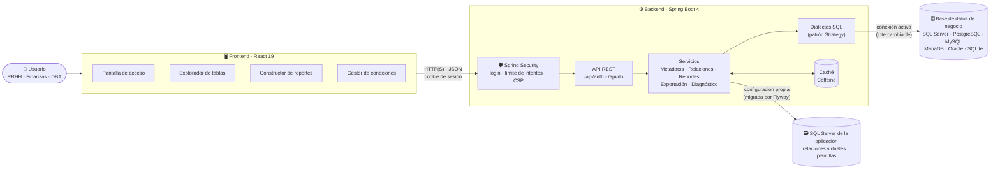

### 2. Recorrido del usuario

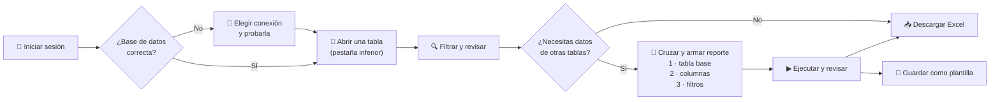

### 3. Inicio de sesión seguro

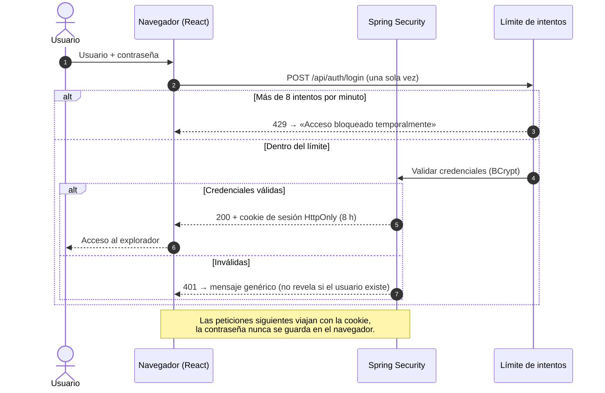

### 4. Cómo se traduce un código a un nombre (sin N+1)

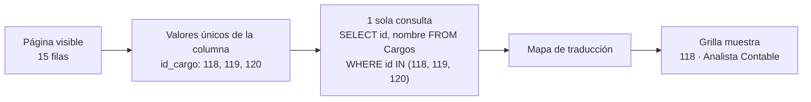

### 5. Datos propios de la aplicación

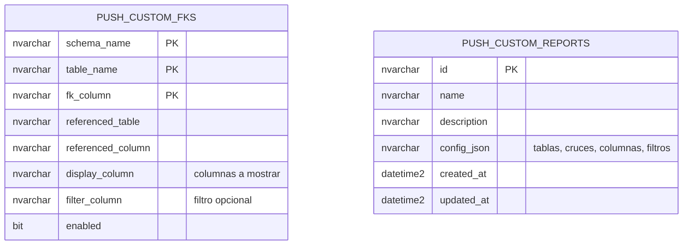

> La aplicación **solo escribe** en estas dos tablas propias. Sobre las tablas de negocio únicamente ejecuta consultas de lectura.

---

## 📋 Requisitos previos

### Para usar la aplicación (usuario final)

| Requisito | Detalle |
|---|---|
| Navegador moderno | Chrome, Edge, Firefox o Safari en sus versiones actuales |
| Credenciales de acceso | Usuario y contraseña entregados por quien instaló la aplicación |
| Datos de conexión | Servidor, base de datos, usuario y contraseña de la base que vas a consultar, si no viene preconfigurada |

### Para instalarla (perfil técnico)

| Requisito | Versión | Necesario para |
|---|---|---|
| **SQL Server** accesible | SQL Server o Azure SQL | **Obligatorio.** Es la base propia de la aplicación, donde Flyway crea `dbo.push_custom_fks` y `dbo.push_custom_reports`. El usuario de conexión debe poder **crear tablas** en el primer arranque. |
| **Docker** *(opción recomendada)* | 20+ | Ejecutar todo sin instalar Java ni Node |
| **Java** *(sin Docker)* | JDK 21 | Compilar y ejecutar el backend |
| **Node.js** *(sin Docker)* | 20 o 22 + npm | Compilar el frontend |
| Puertos libres | `8080` (app) · `5173` (solo en desarrollo) | |
| Acceso de red | Desde el servidor de la app hacia las bases de datos | Firewall o VPN según corresponda |

> [!TIP]
> Para explorar datos, lo ideal es usar un **usuario de base de datos de solo lectura** sobre las tablas de negocio. La aplicación no las modifica, pero el principio de mínimo privilegio suma una capa extra de seguridad.

---

## 🚀 Instalación

### 1. Configurar las variables de entorno

```bash
cp .env.example .env
```

Completa el archivo `.env`, que **nunca se sube a git** (está en `.gitignore`):

| Variable | Obligatoria | Descripción |
|---|:---:|---|
| `DB_URL` | ✅ | URL JDBC del SQL Server de la aplicación |
| `DB_USERNAME` / `DB_PASSWORD` | ✅ | Credenciales de ese SQL Server |
| `APP_USER` / `APP_PASSWORD` | ✅ | **Usuario y contraseña para entrar a la aplicación** (ver [cómo funciona el acceso](#-cómo-funciona-el-acceso)) |
| `EXPORT_MAX_ROWS` | | Máximo de filas por exportación a Excel (por defecto `50000`) |
| `EXPORT_MAX_CONCURRENT` | | Exportaciones simultáneas permitidas (por defecto `2`) |
| `DB_POOL_MAX_SIZE` / `DB_POOL_MIN_IDLE` | | Tamaño del pool de conexiones (por defecto `10` / `2`) |
| `SESSION_COOKIE_SECURE` | | Usa `true` en producción con HTTPS (el perfil `prod` ya lo activa) |
| `SESSION_IDLE_TIMEOUT` | | Cierre de sesión por inactividad (por defecto `30m`) |
| `SESSION_MAX_LIFETIME` | | Duración máxima de una sesión aunque haya actividad (por defecto `8h`) |
| `DB_QUERY_TIMEOUT_SECONDS` | | Tiempo máximo por consulta SQL; `0` = sin límite (por defecto `120`) |
| `DB_ALLOWED_HOSTS` | | Servidores a los que se permite conectarse desde «Cambiar conexión». Vacío = cualquiera. Ej.: `db01.empresa.local,*.bd.empresa.local,sqlite` |
| `DB_REQUIRE_TLS_VALIDATION` | | `true` obliga a validar el certificado TLS en las conexiones creadas desde la app (por defecto `false`) |
| `APP_MASKED_COLUMNS` | | Columnas que se muestran como `******` en pantalla y en Excel. Ej.: `sueldo*,rut` (por defecto ninguna) |
| `APP_ALLOWED_ORIGINS` | | Orígenes extra aceptados en peticiones que modifican datos (por defecto el servidor de desarrollo de Vite) |
| `AUDIT_LOG_DIR` / `AUDIT_LOG_MAX_HISTORY` | | Carpeta y días de retención del registro de auditoría (por defecto `logs` / `365`) |
| `SPRING_PROFILES_ACTIVE` | | `prod` detrás de un proxy HTTPS · `dev` para desarrollo local (ver [perfiles](#perfiles-de-configuración)) |

Todas las variables nuevas son opcionales y sus valores por defecto mantienen el comportamiento habitual de la aplicación.

#### Perfiles de configuración

| Perfil | Cuándo usarlo | Qué cambia |
|---|---|---|
| *(ninguno)* | Uso general | Valores por defecto de la tabla anterior |
| `dev` | Desarrollo local | Acepta el certificado autofirmado de un SQL Server local, sesión de 8 h por inactividad y logs en modo DEBUG |
| `prod` | Detrás de un proxy inverso con HTTPS | Cookie `Secure`, cabecera HSTS, respeta `X-Forwarded-*` del proxy y oculta detalles de error y de salud |

### 2. Ejecutar

<details open>
<summary><b>Opción A · Docker (recomendada)</b></summary>

```bash
docker build -t multidb-workbook .
docker run -d --name multidb-workbook -p 8080:8080 --env-file .env \
  -v multidb-audit:/app/logs --restart unless-stopped multidb-workbook
```
Abre **http://localhost:8080**. Para verificar el estado: `curl http://localhost:8080/actuator/health` (Docker también lo revisa solo con su `HEALTHCHECK`). El volumen `multidb-audit` conserva el registro de auditoría entre despliegues. En producción detrás de HTTPS agrega `-e SPRING_PROFILES_ACTIVE=prod`.
</details>

<details>
<summary><b>Opción B · Desarrollo local (con recarga en caliente)</b></summary>

```bash
# Terminal 1 · Backend (puerto 8080), con el perfil de desarrollo
SPRING_PROFILES_ACTIVE=dev ./mvnw spring-boot:run

# Terminal 2 · Frontend (puerto 5173, con proxy hacia el backend)
cd frontend && npm install && npm run dev
```
Abre **http://localhost:5173**.
</details>

<details>
<summary><b>Opción C · Un único archivo .jar</b></summary>

```bash
cd frontend && npm ci && npm run build && cd ..
rm -rf src/main/resources/static && mkdir -p src/main/resources/static
cp -r frontend/dist/* src/main/resources/static/
./mvnw clean package -DskipTests
java -jar target/PushDbTemplate-1.1.0.jar
```
Ejecuta el `.jar` desde la carpeta que contiene el `.env`. Abre **http://localhost:8080**.
</details>

### 🔑 Cómo funciona el acceso

- Existe **un solo usuario**, definido por `APP_USER` y `APP_PASSWORD`. No hay pantalla de registro.
- Al arrancar, el servidor crea ese usuario **en memoria** y cifra la contraseña con **BCrypt**. No se guarda en ninguna base de datos.
- **Para cambiar la contraseña:** edita el `.env` y **reinicia** la aplicación.
- Si faltan `APP_USER` o `APP_PASSWORD`, la aplicación **no arranca**. Es intencional, para que nunca quede expuesta sin protección.
- Tras 8 intentos fallidos en un minuto desde la misma IP, el acceso se bloquea temporalmente.

---

## 📖 Manual de uso

> Pensado para personas sin conocimientos técnicos. Todo se hace con clics.

### Paso 1 · Ingresar
1. Abre la dirección de la aplicación en tu navegador.
2. Escribe tu **usuario** y **contraseña**. Puedes usar el ícono 👁 para ver lo que escribiste.
3. Presiona **Iniciar sesión** o la tecla Enter.

| Si ves este mensaje… | Qué hacer |
|---|---|
| *Usuario o contraseña incorrectos* | Revisa mayúsculas y minúsculas, y que Bloq Mayús esté desactivado. |
| *Acceso bloqueado temporalmente* | Hubo muchos intentos fallidos. Espera unos minutos. |
| *No pudimos conectar con el servidor* | Revisa tu conexión o avisa al administrador. |
| *Tu sesión ha expirado* | Vuelve a ingresar tu contraseña. La sesión dura 8 horas. |

### Paso 2 · Elegir la base de datos *(solo si no viene preconfigurada)*
1. Haz clic en el botón de conexión, en la parte superior derecha.
2. Elige el motor (SQL Server, PostgreSQL, MySQL, etc.) y completa servidor, base de datos, usuario y contraseña.
3. Presiona **Probar conexión** y, si todo está bien, **Conectar y cargar**.
4. Opcional: **Guardar favorito** para la próxima vez. Por seguridad, la contraseña no se guarda.

### Paso 3 · Explorar una tabla
1. En la **barra inferior** verás las tablas como pestañas. Haz clic en una, o búscala con **Buscar hoja**.
2. Usa **Anterior / Siguiente** y el selector de filas para recorrer los registros.
3. **Filtrar registros:** elige la columna, la condición y el valor, y presiona **Aplicar filtro**. Para volver a ver todo, usa la ✕ del filtro activo.

### Paso 4 · Ver nombres en vez de códigos
1. Entra en **Estructura** (botón junto a *Registros*).
2. En la columna que contiene códigos (por ejemplo `id_cargo`), presiona **Vincular tabla**.
3. Elige la tabla que tiene los nombres (por ejemplo *Cargos*), su columna de código y los datos que quieres mostrar.
4. Guarda con ✓. Desde ese momento la grilla y el Excel mostrarán `118 · Analista Contable`.
5. En la pestaña **Inicio**, el selector **ID / Valor real / Ambos** cambia cómo se muestran.

### Paso 5 · Descargar a Excel
1. Ve a la pestaña **Descargar reporte**.
2. En **Columnas**, marca las que quieres incluir.
3. Presiona **Exportar a Excel (.xlsx)** para descargar la tabla completa con los filtros aplicados, o **Exportar vista (CSV)** para descargar solo lo que ves en pantalla.

### Paso 6 · Cruzar varias tablas en un reporte
1. Haz clic en **Cruzar y armar reportes**, arriba al centro.
2. **① Tabla de partida:** elige la tabla principal, por ejemplo *Empleados*.
3. Revisa las **relaciones detectadas** y presiona **Unir y reemplazar** o **Al final** para sumar otra tabla. También puedes usar **+ Unir otra tabla**.
4. **② Campos para tu Excel:** marca las columnas, ordénalas con ↑ ↓ y cambia su encabezado.
5. **③ Filtrar y ordenar:** agrega condiciones, por ejemplo *estado igual a "Activo"*, y el orden.
6. Presiona **Ejecutar consulta** para ver la vista previa y luego **Descargar Excel (.xlsx)**.
7. **Guardar plantilla** te permite repetir el mismo reporte otro día desde **Mis plantillas**.

### Paso 7 · Modo Fácil o Modo DBA
- **Modo Fácil** (por defecto): lenguaje simple, ideal para RRHH y Finanzas.
- **Modo DBA**: muestra nombres técnicos, el SQL generado y la **consola de diagnóstico** (pestaña *Rendimiento y seguridad*).

> [!TIP]
> El botón **Guía**, en la barra superior, abre una guía interactiva dentro de la aplicación, con consejos y atajos.

---

## 🛡️ Seguridad

| Riesgo | Cómo se mitiga |
|---|---|
| Inyección SQL | Tablas y columnas se validan contra el catálogo real del motor (*whitelist*), los identificadores se escapan según cada dialecto y los valores van parametrizados. |
| Fórmulas maliciosas en Excel/CSV | Los valores que empiezan con `=`, `+`, `-`, `@` o caracteres de control se neutralizan antes de exportar. |
| Fuerza bruta | Límite de 8 intentos por minuto por IP (respuesta 429). |
| Robo de credenciales | La contraseña se envía una sola vez, se cifra con BCrypt en el servidor y nunca se almacena en el navegador. La sesión usa una cookie `HttpOnly` + `SameSite=Lax`. |
| Enumeración de usuarios | El mensaje de error de login es genérico y no indica si el usuario existe. |
| Exposición de errores internos | Los errores se devuelven con un identificador de correlación, sin trazas ni SQL. |
| Agotamiento de recursos | Límite de filas exportables, semáforo de exportaciones concurrentes y Excel en *streaming*. |
| Contenedor | La imagen Docker se ejecuta con un usuario sin privilegios (`appuser`), con `HEALTHCHECK` y apagado ordenado. |
| Falsificación de peticiones (CSRF) | Además de `SameSite=Lax`, se rechazan las peticiones que modifican datos cuyo `Origin`/`Referer` no es la propia aplicación. |
| Clickjacking y fuga de información en cabeceras | CSP con `frame-ancestors 'none'`, `Referrer-Policy: no-referrer`, `Permissions-Policy` y HSTS sobre HTTPS. |
| Sesiones abandonadas | Cierre por inactividad (30 min) y duración máxima absoluta (8 h). |
| Uso del servidor para escanear la red interna | Lista opcional de servidores permitidos para «Cambiar conexión» (`DB_ALLOWED_HOSTS`), incluido el acceso a archivos SQLite. |
| Intermediario en la conexión a la base | El certificado TLS se valida por defecto; `DB_REQUIRE_TLS_VALIDATION` lo exige también en las conexiones creadas desde la app. |
| Consultas que bloquean la base | Tiempo máximo por consulta (`DB_QUERY_TIMEOUT_SECONDS`). |
| Exposición de datos personales | Enmascaramiento opcional de columnas (`APP_MASKED_COLUMNS`) y Excel con autor, fecha y clasificación «Confidencial – uso interno». |
| Trazabilidad | Registro de auditoría en `logs/audit.log`: inicios y cierres de sesión, intentos fallidos y bloqueados, cambios de conexión, exportaciones (con cantidad de filas), plantillas y relaciones. |
| Dependencias vulnerables | `npm audit` en cada build, OWASP Dependency-Check semanal, Dependabot y SBOM CycloneDX incluido en el JAR. |

El detalle de cada control frente a ISO/IEC 27001, 27002 y 25010 está en [docs/cumplimiento-iso.md](docs/cumplimiento-iso.md).

#### Registro de auditoría

Cada evento es una línea `clave=valor` en `logs/audit.log` (rotación diaria, 365 días por defecto). Nunca se registran contraseñas, valores de filtros ni datos de negocio:

```
2026-11-11T15:37:55.129-03:00 event=EXPORT_TABLE outcome=SUCCESS user=admin ip=10.0.0.5 table=dbo.Empleados columns=8 filtered=true rows=1520
2026-11-11T15:41:02.004-03:00 event=LOGIN outcome=FAILURE user=admin ip=10.0.0.9 reason=BadCredentialsException
```

---

## ✅ Calidad y pruebas

```bash
./mvnw verify                        # 329 pruebas de backend + cobertura mínima de 80 % (JaCoCo)
cd frontend && npm test              # 40 pruebas de frontend (Vitest + Testing Library)
cd frontend && npm run lint          # análisis estático (oxlint)
cd frontend && npm audit             # vulnerabilidades conocidas en dependencias
```

El reporte de cobertura queda en `target/site/jacoco/index.html` y el SBOM en `target/classes/META-INF/sbom/application.cdx.json`. En GitHub, el workflow **CI** (`.github/workflows/ci.yml`) ejecuta todo lo anterior y construye la imagen Docker en cada push y pull request. El workflow **Security scan** corre OWASP Dependency-Check cada semana, y Dependabot propone actualizaciones de dependencias.

Cubren autenticación y límite de intentos, controladores REST, metadatos y caché, relaciones, reportes multi-tabla, exportación a Excel, diagnóstico, conexiones dinámicas, dialectos SQL y utilidades del frontend (CSV seguro, conexiones guardadas, accesibilidad de modales).

---

## 📂 Estructura del proyecto

```
PushDbTemplate/
├── src/main/java/.../PushDbTemplate/
│   ├── config/        Seguridad, auditoría, límite de intentos, filtros de origen y sesión, caché
│   ├── controller/    API REST: /api/auth (acceso) y /api/db (datos y reportes)
│   └── service/       Metadatos, relaciones, reportes, exportación, enmascaramiento, diagnóstico,
│       └── dialect/   un dialecto por motor (SQL Server, PostgreSQL, MySQL, MariaDB, Oracle, SQLite)
├── src/main/resources/
│   ├── application.yaml        Configuración (lee el .env)
│   ├── application-dev.yaml    Perfil de desarrollo local
│   ├── application-prod.yaml   Perfil de producción (detrás de HTTPS)
│   ├── logback-spring.xml      Logs + archivo de auditoría separado
│   └── db/migration/           Migraciones Flyway
├── src/test/                   Pruebas de backend
├── frontend/
│   ├── public/                 Logos y favicon (ver «Identidad visual»)
│   └── src/
│       ├── components/         Login, Ribbon, grilla, pestañas, modales y constructor de reportes
│       ├── context/            Sesión (AuthContext) y notificaciones (ToastContext)
│       ├── hooks/ · utils/     Accesibilidad de modales, CSV seguro, relaciones
│       └── index.css           Sistema de diseño y responsive
├── docs/
│   ├── cumplimiento-iso.md     Controles ISO 27001/27002 y calidad ISO 25010
│   └── screenshots/            Capturas del README
├── .github/                    CI, escaneo de seguridad y Dependabot
├── logs/                       Registro de auditoría (generado, no se versiona)
├── CHANGELOG.md                Historial de versiones
├── Dockerfile                  Build multi-stage con HEALTHCHECK
└── .env.example                Plantilla de configuración
```

### 🎨 Identidad visual

Los logos viven en `frontend/public/` y Vite los copia tal cual al build (`dist/` → `src/main/resources/static/`), por lo que se referencian con rutas absolutas (`/archivo`).

<table>
  <tr>
    <td align="center"></td>
    <td align="center"></td>
    <td align="center"></td>
  </tr>
  <tr>
    <td align="center"><code>favicon-64.png</code><br>64 × 58 px · PNG</td>
    <td align="center"><code>max_andres_head_256.webp</code><br>256 × 234 px · WebP</td>
    <td align="center"><code>logo_max_andres_160.webp</code><br>107 × 160 px · WebP</td>
  </tr>
</table>

| Archivo | Dónde se usa |
| :-- | :-- |
| `favicon-64.png` | Ícono de la pestaña del navegador (`frontend/index.html`) |
| `max_andres_head_256.webp` | Barra superior (`Ribbon.jsx`), marca compacta del login en móvil (`LoginModal.jsx`), `apple-touch-icon` y encabezado de este README |
| `logo_max_andres_160.webp` | Panel lateral de la pantalla de acceso (`LoginModal.jsx`) |

Para reemplazar un logo basta con sobrescribir el archivo manteniendo su nombre; si cambia el nombre o la proporción, actualiza las referencias anteriores y las medidas en `frontend/src/index.css` (`.excel-logo`, `.login-aside-logo`, `.login-brand-compact-logo`). Luego recompila el frontend.

---

## ❓ Preguntas frecuentes

<details>
<summary><b>¿Puede modificar o borrar datos de mi base de datos?</b></summary>
<br>
No. Sobre las tablas de negocio solo ejecuta consultas de lectura. Las únicas escrituras ocurren en sus dos tablas propias de configuración (relaciones virtuales y plantillas).
</details>

<details>
<summary><b>¿Cómo sé quién descargó qué información?</b></summary>
<br>
En el registro de auditoría <code>logs/audit.log</code>: cada exportación queda con usuario, IP, tabla o reporte, cantidad de columnas y de filas, y la fecha. Además, el propio archivo Excel guarda quién lo exportó y cuándo (en Excel: <i>Archivo → Información → Propiedades</i>).
</details>

<details>
<summary><b>Me pide iniciar sesión de nuevo después de un rato</b></summary>
<br>
Es intencional: la sesión se cierra tras 30 minutos sin actividad y, en cualquier caso, a las 8 horas. Quien administra la instalación puede ajustarlo con <code>SESSION_IDLE_TIMEOUT</code> y <code>SESSION_MAX_LIFETIME</code>.
</details>

<details>
<summary><b>¿Pueden usarla varias personas al mismo tiempo?</b></summary>
<br>
No está pensada para eso. Tiene un solo usuario, y la conexión activa es común para toda la aplicación: si alguien cambia de base de datos, cambia para todos. Para un equipo, lo recomendable es que cada persona ejecute su propia instancia.
</details>

<details>
<summary><b>La aplicación no arranca</b></summary>
<br>
Revisa que exista el archivo <code>.env</code> con <code>APP_USER</code>, <code>APP_PASSWORD</code>, <code>DB_URL</code>, <code>DB_USERNAME</code> y <code>DB_PASSWORD</code>, y que el SQL Server de la aplicación sea accesible y permita crear tablas en el primer arranque.
</details>

<details>
<summary><b>Olvidé la contraseña</b></summary>
<br>
No hay recuperación automática. Quien administra la instalación debe definir una nueva en <code>APP_PASSWORD</code> dentro del <code>.env</code> y reiniciar la aplicación.
</details>

<details>
<summary><b>Al exportar aparece "demasiadas exportaciones en curso"</b></summary>
<br>
Para no saturar la base de datos, solo se permiten 2 exportaciones a la vez (<code>EXPORT_MAX_CONCURRENT</code>). Espera unos segundos y vuelve a intentarlo.
</details>

---

## 🧭 Limitaciones conocidas y próximos pasos

| Hoy | Evolución propuesta |
|---|---|
| Un único usuario, definido por variables de entorno | Usuarios en base de datos con roles (*Consulta* / *Administrador*) o inicio de sesión con el directorio corporativo (Azure AD / LDAP) |
| Una conexión activa común a toda la aplicación | Conexión independiente por sesión de usuario |
| Sin recuperación de contraseña ni MFA | Flujo de recuperación y segundo factor de autenticación |
| Montos sin separador de miles en la grilla | Formato numérico configurable por columna |
| Las columnas enmascaradas aún se pueden usar en filtros y orden | Permisos por columna según rol |

---

<div align="center">

Desarrollado por **[@maximiliano-andres](https://github.com/maximiliano-andres)**

*Java · Spring Boot · React · SQL · Seguridad de aplicaciones · UX para usuarios de negocio*

</div>
